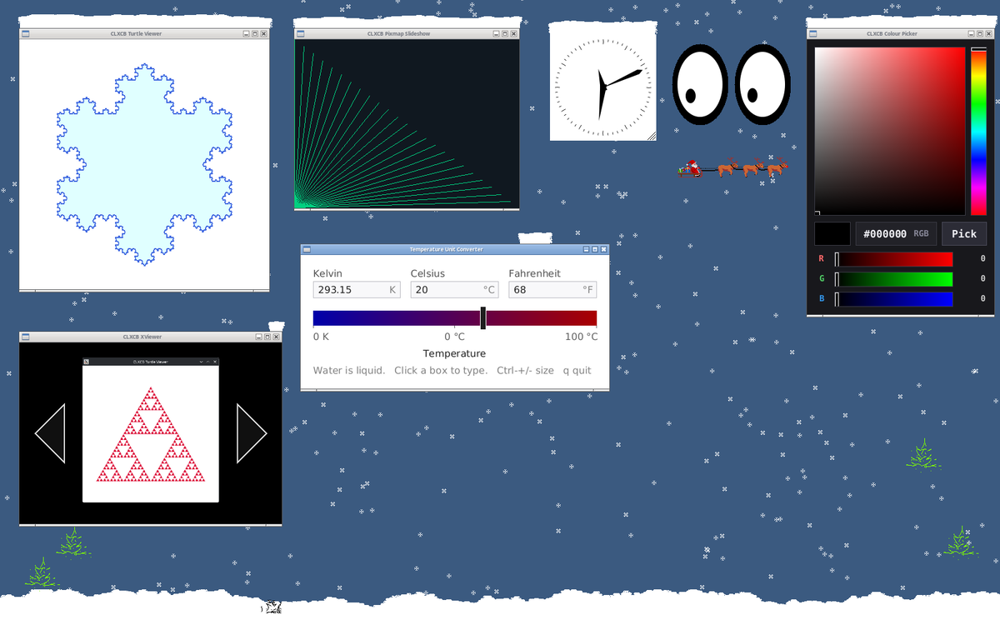
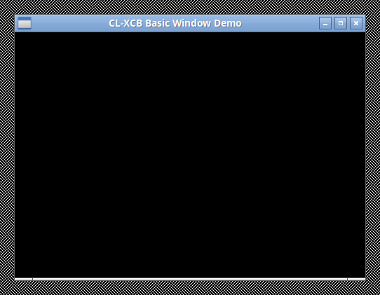
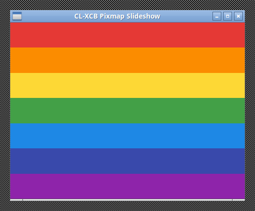
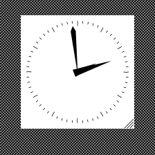
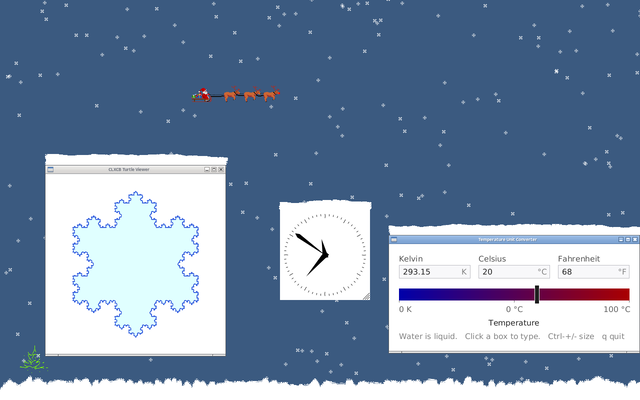
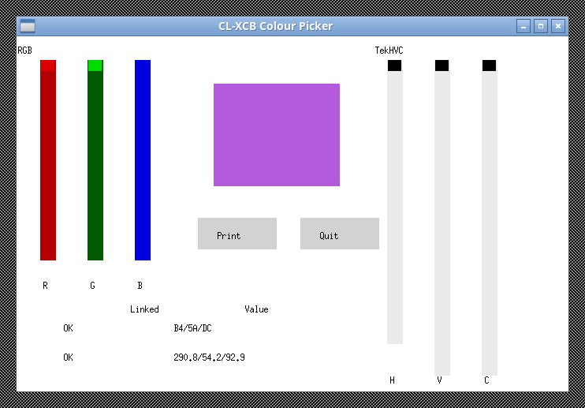
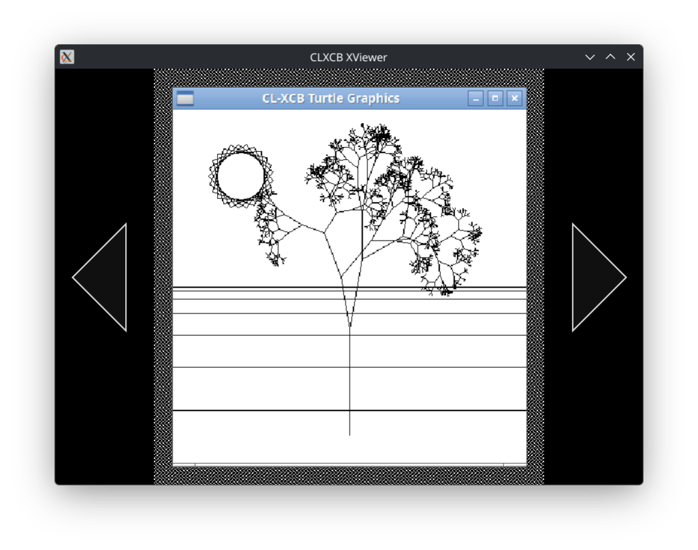

# clxcb-demos

Demo applications for [CLXCB](../clxcb).  Each demo is a small self-contained
program illustrating one part of the X protocol — connections and server
introspection, window creation and event handling, the SHAPE and RENDER
extensions, image upload, and so on — written in Common Lisp on top of the CLXCB
binding.

Some are ports of well-known X11 C programs; some are new.  The Common Lisp
ports preserve the C version's behaviour but I did add some detail here or there
... :)



## Requirements

- SBCL on Linux (the system is `:if-feature :sbcl`) and an X server.
- From Quicklisp: `alexandria`, `bordeaux-threads`, `cffi`, `closer-mop`,
  `file-select`, `with-user-abort`, and what the libraries below pull in
  (`zpb-ttf`, `cl-vectors`, `trivial-garbage`, ...).
- Not in Quicklisp yet; clone them where ASDF finds them, e.g. into
  `~/quicklisp/local-projects/`:
  - [clxcb](https://github.com/amno1/clxcb), and its dependency
    [clxau](https://github.com/amno1/clxau)
  - [clxrm](https://github.com/amno1/clxrm)
  - [clxcb-truetype](https://github.com/amno1/clxcb-truetype)
  - [xact](https://github.com/amno1/xact)
- `libpng` (1.6 or later) for Demo 11's image decoding.

Then `(ql:quickload "clxcb-demos")` loads everything.

## Running a demo

All demos are started through a single framework, `xd:define-demo`, which
provides a lifecycle (`start`, `stop`, `run`, `main`), a connection, and the
ICCCM/EWMH window-manager setup that each demo would otherwise have to repeat.
Demos live in packages named after themselves, with a `DEMO<N>` nickname derived
from the demo's number:

- **Demo 1**: `xcb-demos.quickstart` (`DEMO1`)
- **Demo 2**: `xcb-demos.basic-window` (`DEMO2`)
- **Demo 3**: `xcb-demos.turtle` (`DEMO3`)
- **Demo 4**: `xcb-demos.slideshow` (`DEMO4`)
- **Demo 5**: `xcb-demos.xeyes` (`DEMO5`)
- **Demo 6**: `xcb-demos.xclock` (`DEMO6`)
- **Demo 7**: `xcb-demos.xsnow` (`DEMO7`)
- **Demo 8**: `xcb-demos.xroach` (`DEMO8`)
- **Demo 9**: `xcb-demos.xneko` (`DEMO9`)
- **Demo 10**: `xcb-demos.color-picker` (`DEMO10`)
- **Demo 11**: `xcb-demos.xviewer` (`DEMO11`)
- **Demo 12**: `xcb-demos.thermometer` (`DEMO12`)

and every demo package exports four entry points:

- **`run`** — start the demo on a background thread and return
  immediately.
- **`start`** — same as `run`; both exist so the demo's own package
  and the framework's generic `xd:start` have the same spelling.
- **`stop`** — signal the demo to stop and wait up to five seconds for
  its thread to exit.
- **`main`** — start the demo and *block* until its thread finishes,
  suitable for a `--eval` or a shell one-liner.

From a Lisp REPL, load the system and start whichever demo you want:

```lisp
(asdf:load-system "clxcb-demos")

(xd:start :xeyes)          ; start by keyword
(xd:start 5)               ; or by number
(xd:stop  :xeyes)          ; stop and wait

(demo5:run)                ; or from the demo's own package
(demo6:stop)               ; same thing, spelled differently
```

`(xd:list-demos)` prints every registered demo with its number and
whether it is currently running.

From a shell, `make demo5` (or `make xeyes`) runs `xeyes`, and so on; the
mapping between `demo<N>` targets and packages is the same as the table above.
`make help` lists the targets.  Ctrl+C in the terminal stops the running demo.

### Options

Several demos take per-run options, declared in their `define-demo`
form: `turtle`, `slideshow`, `xeyes`, `xclock`, `xsnow`, `xroach`, `xneko`,
`color-picker`, `xviewer`, and `thermometer`.
Pass them as keyword arguments to `run`, `start` or `main`:

```lisp
(demo6:run :width 300 :background "MidnightBlue" :geometry "-0-0")
(demo5:run :geometry "300x200-10-10")                 ; xeyes, bottom-right
(demo8:run :roaches 30 :squish t)
(demo11:run :directory "~/Pictures/" :slideshow t)
(xd:demo-option-help (xd:find-demo :xclock))   ; list xclock's options
```

Options are type-checked when set, and apply to one run: a later `(demo6:run)`
without options gets the defaults back.

An option you don't pass is looked up in your X resources (via clxrm) before its
default is used, as for any Xt program.  Resource names are the options in Xt
style (`:font-size` is `fontSize`), under the demo's name and class:

```sh
echo 'XClock.background: MidnightBlue
xclock.width: 250
XRoach.roaches: 30' | xrdb -merge
```

`(xd:demo-option-help (xd:find-demo :xclock))` shows each option's resource
name.  A resource value of the wrong type is reported with a warning and
ignored.  From a shell, pass them as `--name value` through `ARGS` (booleans are
`--name` / `--no-name`; quote `#` colours, or the shell treats them as
comments):

```sh
make demo6 ARGS="--help"
make demo6 ARGS="--geometry 250x120-0+0 --no-analog --background '#102030'"
```

### Stopping a demo

`xd:stop` asks the demo's running application to close with
`xact:request-close`.  The request arrives as an event, the way a click on the
window's close button would, so the application's own quit interactor ends its
event loop and cleans up.  A demo blocked waiting for X events wakes up at once,
which is why `(xd:stop :xeyes)` from a REPL returns promptly instead of hanging
until the next user event.  Demos that draw on the root window get a hidden
InputOnly window to receive the request, since the root is not theirs.

## The framework in one page

`xd:define-demo` is the first toplevel form of every demo file.  It creates a
package for the demo, defines a CLOS class for it, and registers a single
instance of that class under a keyword.  The rest of the file is ordinary Lisp.

The framework rests on three separations:

**The demo lifecycle is a CLOS object.**  `start` and `stop` are generic
functions on the demo instance.  A demo is a singleton (one instance per
keyword) retrieved by `xd:find-demo` and never instantiated by the demo file
itself.

**The transport is a mixin.**  `xcb-mixin` provides a single method,
`call-with-context`, which opens an XCB connection, reads the user's X
resources, hands the connection to the demo body, and closes it on unwind.  A
hypothetical CLX-backed demo would mix in a different transport and provide its
own `call-with-context`; the demo body would not change.

**What the demo shows is its application.**  The `:app` given to
`define-demo` names a subclass of `xd:application`, which is an xact
`toplevel` widget.  Its `:kind` says how its window deals with the window
manager, and xact applies the matching ICCCM/EWMH conventions before the window
is mapped:

- `:managed`: an ordinary decorated toplevel with a WM-provided frame (the
  default; Demos 2–4, 10–12, and 5 and 6 with `--decorated`).
- `:undecorated`: WM-managed, but without a frame, using Motif hints (Demo 6).
- `:override-redirect`: the WM never sees the window (Demos 5 and 9).
- `:root`: draws on the root window (or a virtual root), which it does not own
  (Demos 7 and 8).

Demo 1 has no application at all.  For `:managed` and `:undecorated`, xact sets
`WM_NAME`, `WM_CLASS`, `_NET_WM_PID`, `_NET_WM_WINDOW_TYPE`, and the
`WM_DELETE_WINDOW` close protocol; for `:override-redirect` only `WM_NAME`, so
that `xprop` on the window while debugging shows something meaningful.

The application class also declares the demo's options as ordinary slots, and
`define-demo`'s `:options` names the ones a user may set.  A demo body is
called with two variables bound: `d`, the demo instance, and `conn`, the live
connection.  It looks like this:

```lisp
(xd:define-demo :xeyes
    (:wm-title "CLXCB XEyes"
     :resource-class "XEyes"
     :app xeyes-widget
     :options (:width :height :x :y :geometry :shape :distance :decorated :render))
  (run-xeyes d conn))

(defclass xeyes-widget (xd:application)
  ((decorated :initarg :decorated :initform nil :type boolean
              :reader xeyes-decorated
              :documentation "let the WM decorate the window")
   ...)
  (:default-initargs :width 150 :height 100))
```

and `run-xeyes` makes the application with `(xd:make-application d conn ...)`,
which passes it the run's options, title and WM class; sets its kind
(`:override-redirect`, or `:managed` when decorated); realizes and shows it; and
runs its event loop with `xact:run-widget`.  There is no `*conn*` global to
remember and no window-manager boilerplate to write; both are the framework's
job.

## Demo list

### 1 — Quickstart

Quickstart demo:
```
CL-USER> (demo1:start)
#<SB-THREAD:THREAD tid=17376 "QUICKSTART" RUNNING {12067C87C3}>
========================================
       CLXCB Quickstart Demo           
========================================
Connecting to display: :0 ...
Connected.

=== Server ===
  Vendor           : The X.Org Foundation
  Protocol version : X11.0 (server release 12401013)
  Byte order       : LSB (little-endian)
  Resource ID base : #x01C00000
  Resource ID mask : #x001FFFFF
  Max request len  : 65535 words (262140 bytes)
  Motion buf size  : 256

=== Wire format ===
  Image byte order     : LSBFirst (little-endian)
  Bitmap bit order     : LSBFirst
```

No window at all.  Connects, prints a report on the server's configuration
(vendor, protocol version, screens, depths, visuals, advertised extensions),
demonstrates atom interning and resource-ID generation, and disconnects.  The
point is to show the connection lifecycle in isolation.  This is the one demo
whose "screenshot" is terminal output rather than a window.

### 2 — Basic window



The simplest possible interactive window: create, map, event loop, clean
teardown.  Echoes keyboard and mouse events to stdout and into the window.
Closing the window exits.
This is the demo to read first if you want to see how an X11 event loop is
structured.

### 3 — Turtle graphics & viewer


A turtle graphics renderer and script viewer. Executes Common Lisp turtle
drawing scripts (like `demo-3/drawing.lisp` or user-selected files) and renders
the vector segments scaled to the window using a single `PolySegment`
request. Supports choosing files interactively with a file dialog (`o`) and live
reloading (`r`).

### 4 — Slideshow



Six procedurally-generated images are drawn once into off-screen pixmaps and
cycled into a window on a timer.  Each slide change is a single `CopyArea`
request.  Demonstrates pixmaps and the draw-once-display-many pattern.

### 5 — XEyes


The classic two-eyes-follow-the-mouse demo, ported from the X Consortium's C
version.  Two non-rectangular windows track the pointer; the pupils stay inside
the eye rims and (optionally) reach the rim as the cursor approaches the screen
edge.  Exercises the SHAPE extension, the RENDER extension's antialiased
triangle fan, and keyboard focus handling for override-redirect windows.

### 6 — XClock



Analog and digital clock, ported from the Open Group's `xclock.c`.  Supports
RENDER for antialiased hands and ticks, live keybindings (`?` for help), an
optional chime, and a movable/resizable window.  The window has no WM frame; the
demo draws its own resize grip in the bottom-right corner and moves itself when
dragged, the same way `xeyes` does.

### 7 — XSnow



Snow falls on the desktop, drifts in the wind, and accumulates on top of window
frames and at the bottom of the screen.  Draws directly on the root window; on a
compositing WM, it draws on a transparent click-through overlay instead, so that
the falling snow can be blended over the desktop rather than replacing it.

This demo, and the next two, need a real X server.  They will not run on
XWayland, because Wayland does not let a client see — or draw over — windows it
did not create, and these demos need to know the positions of other windows on
the screen.  If you are on Wayland, run them under Xephyr or Xvfb.

### 8 — XRoach


Cockroaches crawl on the root window and hide under client windows; they can be
squished with the mouse.  Also draws directly on the root window, and has the
same XWayland limitation as XSnow.

### 9 — Xneko


A small cat runs across the screen chasing the pointer.  The cat window is
override-redirect and clipped to the sprite's mask with the SHAPE extension, so
it is not a rectangle.  Five sprite variants (`:neko`, `:dog`, `:bsd`,
`:sakura`, `:tomoyo`) ship with the demo.  Same XWayland limitation as XSnow.

### 10 — Colour picker



A modern, antialiased colour picker featuring TrueType fonts, scalable
dimensions, interactive SV square and Hue strip, and mode-dependent RGB / HSV
sliders.

### 11 — Xviewer



Scans a directory for image files, decodes them through pluggable backends
(currently libpng for `*.png`), uploads each to a pixmap with `PutImage`, and
displays it.  Translucent prev/next triangles are alpha-blended into the pixmap
before display; clicking one advances the slideshow.  Demonstrates image upload
and the alpha-blending arithmetic you would otherwise need RENDER for.

### 12 — Thermometer


A temperature unit converter with one slider and three scales (Kelvin, Celsius,
and Fahrenheit).  Drag the slider, or click any box and type a temperature; the
other boxes and the slider update automatically.  Illustrates `xact:relate`
multi-way relations, dynamic TrueType font scaling, and reactive widget
composition.

## Status & Version

The current version is **0.5.0** (public pre-1.0 release). The framework, option parsing, lifecycle protocols, and demo applications are stable and feature-complete across all 12 demos.

## License

The framework and original demo code are released under the [GNU General Public License v3.0 or later (GPLv3+)](LICENSE). Individual demo ports retain their upstream licenses (MIT for Demos 1 and 5, X11/DEC/Open Group for Demo 6, and J.T. Anderson permissive terms for Demo 8). See the root [LICENSE](LICENSE) file and individual source headers for details.
