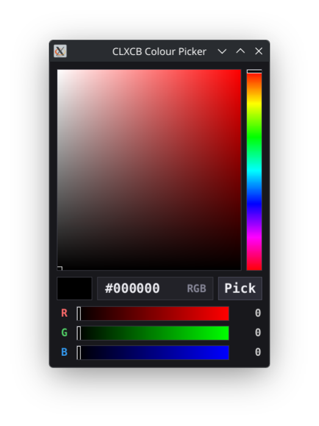

# Demo 10 — Colour Picker

<p align="center">
  <a href="picker.png">
    
  </a><br/>
</p>

A modern, antialiased colour picker window built with `xact`'s `xact:color-picker` widget (system `xact/color-picker`).

Features an interactive Saturation/Value (SV) gradient square, a continuous Hue spectrum strip, a screen eyedropper button ("Pick") that samples pixels from any open desktop window, and three numeric adjustment sliders (supporting both RGB and HSV modes).

> [!NOTE]
> This demo requires a real X11 server (Xephyr or Xvfb are OK) for the full functionality. It will not work properly under pure XWayland due to pointer query restrictions.  The main color-picking window with sliders will work to choose the color, but the part to pick color out from the desktop will not (the pick button functionality).

## Technical Highlights

- **Window kind**: `:managed`.
- **Reactive Widget**: Combines high-resolution antialiased 2D rendering with `xact`'s interactive component framework:
  - Saturation/Value square with bi-linear color gradients.
  - Linear Hue strip.
  - Dual slider modes: RGB (Red, Green, Blue) and HSV (Hue, Saturation, Value).
  - Screen eyedropper (`xact:pick-color-from-screen`): Temporarily grabs pointer input and samples the exact pixel color under the cursor from the X11 root window.
- **Typography & Styling**: Clean TrueType font rendering for values and labels via `clxcb-truetype`.

## Loading in REPL

```lisp
;; Load the demos system
(asdf:load-system "clxcb-demos")

;; Start the colour picker in RGB mode
(demo10:run)

;; Start in HSV mode with custom window dimensions
(demo10:run :mode :hsv :width 400 :height 550)

;; Cleanly stop the demo from the REPL
(demo10:stop)
```

## Running with Makefile

```bash
# Run Demo 10
make demo10

# Or using friendly alias:
make color-picker

# Pass options:
make demo10 ARGS="--mode hsv"
make demo10 ARGS="--geometry 400x550+150+150"
make demo10 ARGS="--help"
```

## Options

`:geometry` (string) — Standard geometry string (e.g. `"360x500+100+100"`).
`:width`  (integer >= 240, default: `360`) — Window width in pixels
`:height` (integer >= 320, default: `500`) — Window height in pixels
`:x` / `:y` (integer, default: `100`, `100`) — Initial window coordinates.
`:mode` (`:rgb` / `:hsv`, default: `:rgb`) — Initial slider mode (`:rgb` or `:hsv`).
`:background` (string / integer) — Window background colour name or hex value.
`:foreground` (string / integer) — Text and label colour name or hex value.
`:font-family` (string) — Font family for slider values and labels.
`:font-size` (integer) — Font pixel size.

## Controls

- Mouse Drag     Drag anywhere on the **SV square**, **Hue strip**, or **sliders** to adjust colors.
- Click **Pick** Activate the screen eyedropper. Click anywhere on the desktop to sample that pixel's colour.
- `r` or `R`     Switch sliders to **RGB** mode (Red, Green, Blue).
- `h` or `H`     Switch sliders to **HSV** mode (Hue, Saturation, Value).
- `Ctrl+m`       Keyboard **move mode** (use arrow keys, press `Return` or `Escape` to finish).
- `Ctrl+r`       Keyboard **resize mode** (use arrow keys, press `Return` or `Escape` to finish).

## Quit:

- `q` or `Escape`
- Close the window via your window manager's title bar close button (`WM_DELETE_WINDOW`)
- Stop from the REPL with `(demo10:stop)`
