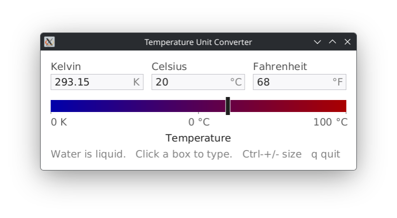

# Demo 12 — Thermometer (Temperature Unit Converter)

<p align="center">
  <a href="thermometer.png">
    
  </a><br/>
</p>

A reactive multi-scale temperature converter with one continuous slider and three linked digital readouts: **Kelvin** (K), **Celsius** (°C), and **Fahrenheit** (°F). The slider spans from absolute zero (−273.15 °C) to the boiling point of water (100 °C), transitioning smoothly from deep ice blue to intense warm red.

You can drag the slider or click directly inside any box to type a temperature; all other boxes and the slider update instantaneously.

## Technical Highlights

- **Window kind**: `:managed`.
- **Multi-Way Reactive Relations (`xact:relate`)**:
  - The temperature state is maintained across three cells (`:k`, `:c`, and `:f`) tied by a three-way relation.
  - Editing any one scale calculates the other two without cascading updates, circular callback loops, or synchronization glitches.
  - Calculations are executed using Common Lisp exact rational numbers (e.g. 36.6 °C is precisely `183/5`).
- **Dynamic Proportional Scaling**:
  - Font size and UI layout are linked by an `:scale <-> :font-size` relation.
  - Keyboard shortcuts (`Ctrl++`, `Ctrl+-`, `Ctrl+0`) and mouse drag gestures dynamically recompute typography metrics, widget padding, and window dimensions on the fly.
- **Typography**: Uses `Runes` (`runes/xcb`) for antialiased labels and digits.

## Loading in REPL

```lisp
;; Load the demos system
(asdf:load-system "clxcb-demos")

;; Start thermometer at default room temperature (20 °C)
(demo12:run)

;; Start at body temperature (37 °C) with a larger font
(demo12:run :celsius 37 :font-size 20)

;; Cleanly stop the demo from the REPL
(demo12:stop)
```

## Running with Makefile

```bash
# Run Demo 12
make demo12

# Or using friendly alias:
make thermometer

# Pass options:
make demo12 ARGS="--celsius 25 --font-size 18"
make demo12 ARGS="--geometry +200+200"
make demo12 ARGS="--help"
```

## Options

`:celsius` (number, default: `20`) — Starting temperature in degrees Celsius.
`:font-size` (integer 6..96, default: `15`) — Starting base font size in pixels (everything scales proportionally).
`:x` / `:y` (integer, default: `100`, `100`) — Initial screen position.
`:geometry` (string) — Standard geometry string (e.g. `"+150+150"`).

## Controls

- Drag Slider               Slide left or right to adjust temperature smoothly.
- Click a Box               Click any unit box to edit its value directly. Type numbers (supports decimals and negatives); press `Return` or `Tab` (or click elsewhere) to confirm, or `Escape` to cancel and revert.
- `+` / `=`                 Increase temperature by **1 °C**.
- `-`                       Decrease temperature by **1 °C** (clamped at absolute zero).
- `Ctrl++` / `Ctrl+=`       Scale entire interface **larger**.
- `Ctrl+-`                  Scale entire interface **smaller**.
- `Ctrl+0`                  Reset interface to **100% (default scale)**.
- `Ctrl-drag`               Hold `Control` and left-drag to move the window.
- `Alt-drag` / `Super-drag` Hold `Alt` or `Super` and drag to scale the window interactively (drag right/up to enlarge, left/down to shrink).

## Quit:

- `q` or `Escape` (when not actively editing a text box)
- Close the window via your window manager's title bar close button (`WM_DELETE_WINDOW`)
- Stop from the REPL with `(demo12:stop)`
