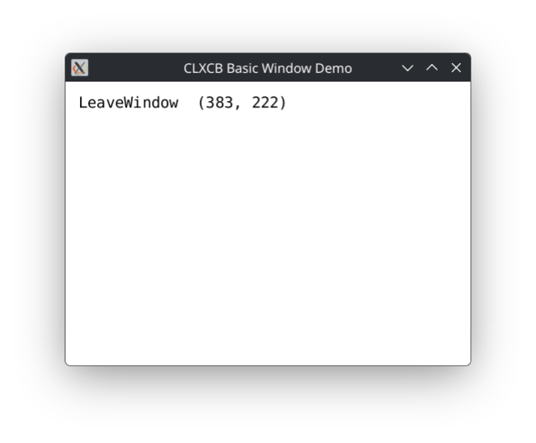

# Demo 2 — Basic Window

<p align="center">
  <a href="demo2.png">
    
  </a><br/>
</p>
An interactive window demonstration illustrating the fundamental mechanics of X11 window creation, event mask configuration, TrueType font rendering, and an event loop driven by `xact`.

Every keyboard, mouse, motion, exposure, and window management event is logged to standard output and rendered live into the window.

## Technical Highlights

- **Window kind**: `:managed` (managed by the window manager with standard window borders, decorations, and title).
- **Event Handling**: Configures an event mask listening for:
  - `KeyPress` and `KeyRelease` (with modifier bitmask decoding: Shift, Control, Alt, Super).
  - `ButtonPress` and `ButtonRelease` (identifying Left, Middle, Right, Scroll Up, Scroll Down).
  - `EnterNotify` and `LeaveNotify` (pointer entering or leaving the window).
  - `MotionNotify` (pointer movement coordinates).
  - `Expose` and `ConfigureNotify` (geometry and structure notify).
  - Client message protocols (`WM_DELETE_WINDOW`).
- **Typography**: Uses `Runes` (`runes/xcb`) to render antialiased text ("DejaVu Sans Mono") directly into the window using X11 RENDER.
- **Event Loop**: Powered by `xact:run-widget` with clean resource destruction on exit.

## Loading in REPL

```lisp
;; Load the demos system
(asdf:load-system "clxcb-demos")

;; Start the demo on a background thread
(demo2:run)

;; Alternatively, start by keyword or number:
(xd:start :basic-window)
(xd:start 2)

;; Cleanly stop the demo from the REPL
(demo2:stop)
```

## Running with Makefile

```bash
# Run Demo 2
make demo2

# Or using friendly alias:
make basic-window
```

## Available Options

Demo 2 uses standard window placement defaults (width: 500, height: 350, x: 100, y: 100) and does not take additional custom command-line options.

## Quit:

Close the window via your window manager's title bar close button (`WM_DELETE_WINDOW`) or stop from the REPL with `(demo2:stop)`.
