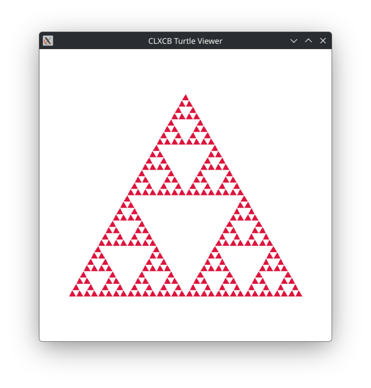

# Demo 3 — Turtle Graphics & Viewer

<p align="center">
  <a href="demo3.png">
    
  </a><br/>
</p>

An interactive Lisp turtle graphics renderer and script viewer for CLXCB. It executes Common Lisp turtle drawing scripts, renders the resulting vectors, and allows loading or reloading drawings dynamically.

The demo ships with four sample drawing scripts in [scenes/](scenes):
- [scenes/snowflake.lisp](scenes/snowflake.lisp) — The Koch Snowflake fractal (loaded by default).
- [scenes/sierpinski.lisp](scenes/sierpinski.lisp) — The Sierpinski Curve space-filling fractal.
- [scenes/sierpinski-triangle.lisp](scenes/sierpinski-triangle.lisp) — Sierpinski triangle fractal gasket.
- [scenes/square-and-star.lisp](scenes/square-and-star.lisp) — Square and 5-pointed star.

You can press `o` at runtime to choose and switch between drawing scripts through the graphical file chooser.

## The Turtle Scripting Language

Drawing files are written in standard Common Lisp. Each drawing script is loaded and evaluated in its own programmatically generated package (`TURTLE-XXXX`) that uses `:cl` and `:turtle`. The active package is held in `turtle:*current-script-package*` and automatically deleted when switching scenes or when the viewer exits, leaving zero garbage behind. Available turtle primitives:

- **`(pen-down)`**: Lower the pen so subsequent movements draw lines.
- **`(pen-up)`**: Raise the pen so movements do not draw.
- **`(forward distance)`**: Move forward in the current heading by `distance` units.
- **`(backward distance)`** (or **`(back distance)`**): Move backward by `distance` units.
- **`(heading &optional degrees)`**: Get the current heading, or set the absolute heading in degrees (0 = up/north, 90 = right/east, 180 = down/south, 270 = left/west).
- **`(turn degrees)`**: Turn relative to the current heading (+ clockwise, − counter-clockwise).
- **`(left degrees)`**: Turn counter-clockwise by `degrees`.
- **`(right degrees)`**: Turn clockwise by `degrees`.
- **`(set-position x y)`** (or **`(goto x y)`**): Move the turtle to `(x, y)` directly.
- **`(set-x x)`** / **`(set-y y)`**: Move turtle horizontally or vertically.
- **`(home)`**: Return turtle to center `(200, 200)` and heading 0.
- **`(circle radius &optional (extent 360) (clockwise t))`**: Draw an arc/circle of `radius` centered at turtle position.
- **`(color &optional color-spec)`**: Get or set pen color and default fill color (`"royal blue"`, `"#ff0000"`, `:blue`, 0..15).
- **`(fill-color &optional color-spec)`**: Get or set polygon fill color.
- **`(width &optional w)`**: Get or set stroke line width in pixels.
- **`(begin-shape)`**: Begin recording vertices for a filled polygon.
- **`(fill-shape &optional color-spec)`**: Close and fill the recorded polygon.
- **`(reset)`**: Reset the turtle position to center `(200, 200)`, heading 0, pen down, and default colors.

Scripts simply execute top-level forms or helper functions with zero package boilerplate:

```lisp
(color "royal blue")
(width 2)
(pen-down)
(forward 100)
(right 120)
(forward 100)
(right 120)
(forward 100)
```

## Technical Highlights

- **Window kind**: `:managed`.
- **Dynamic Coordinate Fitting**: The turtle operates in a virtual 400×400 coordinate space. Vector segments are scaled dynamically to fit the window with `xd:fit-transform`, preserving relative proportions and aspect ratios on window resize.
- **Batched Vector & Polygon Rendering**: Line segments are drawn in an optimized `xcb:poly-segment` request and filled shapes via `xcb:fill-poly`.
- **Live File Loading & File Chooser**: Interactive file dialog powered by `file-select` to select and reload turtle drawings live without restarting the demo. Press `o` to switch drawings at any time.

## Loading in REPL

```lisp
;; Load the demos system
(asdf:load-system "clxcb-demos")

;; Start viewer (loads demo-3/scenes/snowflake.lisp by default)
(demo3:run)

;; Launch specific scenes directly via keyword shortcut:
(demo3:run :triangle)   ;; Sierpinski triangle fractal gasket (243 filled polygons)
(demo3:run :curve)      ;; Sierpinski curve space-filling fractal (1024 segments)
(demo3:run :snowflake)  ;; Koch snowflake fractal (768 segments)
(demo3:run :star)       ;; Square and 5-pointed star

;; Combine scene shortcuts with window geometry options:
(demo3:run :triangle :width 800 :height 800)

;; Or load any custom script by file path:
(demo3:run :file "path/to/custom-drawing.lisp")

;; Alternatively, start by keyword or alias through the framework:
(xd:start :turtle)
(xd:start :turtle-viewer)

;; Stop the demo from REPL
(demo3:stop)
```

## Running with Makefile

```bash
# Run Demo 3 (loads default scenes/snowflake.lisp)
make demo3

# Or using friendly aliases:
make turtle
make turtle-viewer

# Pass a scene shortcut or custom drawing file:
make demo3 ARGS="--scene triangle"
make demo3 ARGS="--file triangle"
make demo3 ARGS="--file demo-3/scenes/sierpinski.lisp"
make demo3 ARGS="--width 800 --height 800"
make demo3 ARGS="--help"
```

## Options

`:scene`  (symbol / string) — Named scene shortcut (e.g. `:triangle`, `:curve`, `:snowflake`, `:star`).
`:file`   (string / pathname / keyword, default: `demo-3/scenes/snowflake.lisp`) — Path or scene keyword of drawing script to load.
`:width`  (integer >= 1, default: `600`) — Initial window width in pixels.
`:height` (integer >= 1, default: `600`) — Initial window height in pixels.
`:x`      (integer) — Initial window position on screen.
`:y`      (integer) — Initial window position on screen.
`:geometry` (string) — Standard X11 geometry string (e.g. `"600x600+100+100"`).

## Controls

- `o` or `O` Open a graphical file dialog to **choose and load** a turtle drawing script.
- `r` or `R` **Reload** the currently loaded drawing script from disk.
- `?`        Print controls help to standard output.

Resizing the window automatically scales the content within it.

## Quit:

- `q` or `Escape`
- Close the window via your window manager's title bar close button
- Stop from the REPL with `(demo3:stop)`
