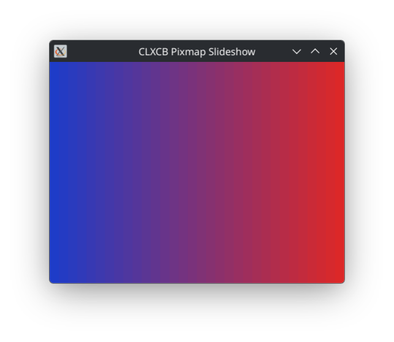

# Demo 4 — Pixmap Slideshow

<p align="center">
  <a href="demo4.png">
    
  </a><br/>
</p>

A procedural graphics slideshow demonstrating off-screen pixmaps and the "draw-once, display-many" pattern in X11.

Six slides are painted once into dedicated off-screen X11 pixmaps at the current window size and cycled to the screen on an automatic timer or manual keypress. Each slide transition is executed as a single `CopyArea` request. When the window is resized, all pixmaps are automatically regenerated to fit the new dimensions.

## Procedural Slides

1. **Rainbow**: Seven horizontal color bands.
2. **Gradient**: 32-band horizontal color interpolation (blue to red).
3. **Checkerboard**: Alternating two-tone grid cells.
4. **Concentric**: Concentric color-shifting rectangles expanding from the center.
5. **Fan**: Diagonal line segments radiating from the bottom-left corner.
6. **Text**: Multi-line typography rendered with core XCB fonts (`poly-text8`).

## Technical Highlights

- **Window kind**: `:managed`.
- **Double Buffering & Off-Screen Pixmaps**: Demonstrates creating pixmaps (`xcb:create-pixmap`), allocating GCs, rendering primitives, and instant blitting with `xcb:copy-area`.
- **Timer & Event Integration**: Driven by `xact:run-widget` with an `xact:interactor` handling periodic timer ticks (default: 1.5 seconds per slide).

## Loading in REPL

```lisp
;; Load the demos system
(asdf:load-system "clxcb-demos")

;; Start the slideshow
(demo4:run)

;; Start with custom dimensions or geometry
(demo4:run :width 640 :height 480 :geometry "640x480+100+100")

;; Cleanly stop the demo
(demo4:stop)
```

## Running with Makefile

```bash
# Run Demo 4
make demo4

# Or using friendly alias:
make slideshow

# Pass options:
make demo4 ARGS="--width 800 --height 600"
make demo4 ARGS="--help"
```

## Options

`:width`  (integer >= 1, default: `480`) — Initial window width in pixels.
`:height` (integer >= 1, default: `360`) — Initial window height in pixels.
`:x`/`:y` (integer, default: `100`, `100`) — Initial window position on screen.
`:geometry` (string) — Standard X11 geometry string (e.g. `"640x480+100+100"`).

## Controls

- `Space` or `n` Advance to the **next** slide.
- `p`            Return to the **previous** slide.
- `Ctrl+m`       Enter keyboard **move mode** (use arrows, press `Return` or `Escape` to finish).
- `Ctrl+r`       Enter keyboard **resize mode** (use arrows, press `Return` or `Escape` to finish).

## Quit:

- `q` or `Escape`
- Close the window via your window manager's title bar close button (`WM_DELETE_WINDOW`)
- Stop from the REPL with `(demo4:stop)`
