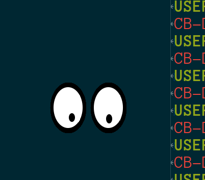

# Demo 5 — XEyes

<p align="center">
  <a href="xeyes.png">
    
  </a><br/>
</p>

A Common Lisp port of the classic X11 `xeyes` demo, originally written by Keith Packard at the MIT X Consortium based on the NeWS demo by Jeremy Huxtable.

Two eyes follow the mouse pointer across the screen. The pupils track pointer movements while remaining constrained within the elliptical eye rims.

## Technical Highlights

- **Window kind**: `:override-redirect` (default; undecorated window floating directly on the screen) or `:managed` when `:decorated t`.
- **SHAPE Extension**: Uses X11 `SHAPE` extension to mask the window outline into a non-rectangular pair of ellipses, making the background completely transparent to the desktop beneath.
- **RENDER Extension**: Renders smooth, antialiased eye contours and pupils using RENDER triangle fans (`TriFan`). If the RENDER extension is disabled or unavailable, falls back to classic X11 `PolyFillArc`.
- **Focus Management**: Override-redirect windows do not receive WM focus; an enter/leave interactor temporarily establishes input focus so keys (`q`, `Escape`, `Ctrl+m`) work seamlessly while hovering.

## Loading in REPL

```lisp
;; Load the demos system
(asdf:load-system "clxcb-demos")

;; Start xeyes with default settings
(demo5:run)

;; Start with custom options
(demo5:run :render t :shape t :distance t :geometry "240x160-20-20")

;; Cleanly stop the demo
(demo5:stop)
```

## Running with Makefile

```bash
# Run Demo 5
make demo5

# Or using friendly alias:
make xeyes

# Pass options:
make demo5 ARGS="--no-shape"
make demo5 ARGS="--geometry 300x200-10-10 --distance"
make demo5 ARGS="--help"
```

## Options

`:geometry` (string) — Standard X11 geometry string (e.g. `"200x120+100+100"`).
`:width` / `:height` (integer >= 1, default: `150` x `100`) — Window dimensions in pixels.
`:x` / `:y` (integer, default: `100`, `100`) — Window position on screen.
`:shape` (boolean, default: `t`) — Use the X11 `SHAPE` extension for non-rectangular eyes (`--shape` / `--no-shape`).
`:render` (boolean, default: `t`) — Use the X11 `RENDER` extension for antialiased rendering (`--render` / `--no-render`).
`:distance` (boolean, default: `nil`) — Pupils reach the outer rim as the cursor approaches screen edges.
`:decorated` (boolean, default: `nil`) — Allow the window manager to decorate the window with title bar and borders.

## Controls

- `Left-drag` Click and drag anywhere on the eyes to move the window (when undecorated).
- `Ctrl+m`    Enter keyboard **move mode** (use arrow keys to move window; `Return` or `Escape` to finish).

## Quit:

- `q` or `Escape` (hover the pointer over the eyes first if undecorated)
- Close the window via your window manager's title bar close button (when `:decorated t`)
- Stop from the REPL with `(demo5:stop)`
