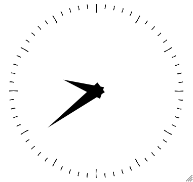

# Demo 6 — XClock

<p align="center">
  <a href="xclock.png">
    
  </a><br/>
</p>

A Common Lisp port of the classic X11 `xclock`, derived from the original C implementation by Tony Della Fera, Dave Mankins, Ed Moy, and later contributors at DEC, MIT, and The Open Group.

Supports analog and digital clock faces, antialiased hands and ticks via the X11 RENDER extension, TrueType typography, live interactive key commands, an on-screen help overlay, an optional hourly/half-hourly chime, and flicker-free resize synchronization.

## Technical Highlights

- **Window kind**: `:undecorated` (default; custom bottom-right resize grip and drag-to-move) or `:managed` when `:decorated t`.
- **RENDER Extension**: Antialiased convex polygons and triangle fans for clock hands and dial tick marks. Falls back to classic `xcb:fill-poly` and `xcb:poly-segment` when RENDER is disabled.
- **Modern Typography**: High-quality TrueType font rendering on the digital face and help overlay via `Runes` (`runes/xcb`).
- **Smooth Resizing**: Implements the `_NET_WM_SYNC_REQUEST` protocol to eliminate resize tearing.

## Loading in REPL

```lisp
;; Load the demos system
(asdf:load-system "clxcb-demos")

;; Start with default analog clock
(demo6:run)

;; Start digital clock with custom colors and geometry
(demo6:run :analog nil :twentyfour t :background "MidnightBlue" :foreground "White" :geometry "300x120-0+0")

;; Cleanly stop the demo
(demo6:stop)
```

## Running with Makefile

```bash
# Run Demo 6
make demo6

# Or using friendly alias:
make xclock

# Pass options:
make demo6 ARGS="--no-analog --background '#102030'"
make demo6 ARGS="--geometry 250x250-0-0 --update 0.5"
make demo6 ARGS="--help"
```

## Options

`:geometry` (string) — Standard geometry string (e.g. `"200x200-10+10"`).
`:width` / `:height` (integer >= 1, default: `164` x `164`) — Window width and height in pixels.
`:x` / `:y` (integer, default: `100`, `100`) — Initial screen position.
`:background` (string / integer) — Background color name or hex value.
`:foreground` (string / integer) — Foreground/dial color name or hex value.
`:hands` (string / integer) — Color of clock hands.
`:highlight` (string / integer) — Color of the hands' borders.
`:analog` (boolean, default: `t`) — Start with analog face (`--analog` / `--no-analog`).
`:analog24` (boolean, default: `nil`) — Use 24-hour analog dial.
`:twentyfour` (boolean, default: `t`) — 24-hour format on digital face (12-hour if `nil`).
`:brief` (boolean, default: `nil`) — Digital face without date.
`:utime` (boolean, default: `nil`) — Digital face displays universal seconds since epoch.
`:update` (number > 0, default: `1.0`) — Seconds between clock updates (second hand shown when `<= 30`).
`:chime` (boolean, default: `nil`) — Audio beep on the hour and half-hour.
`:padding` (integer >= 0, default: `8`) — Pixels between dial face and window border.
`:render` (boolean, default: `t`) — Use RENDER extension for antialiased hands and ticks.
`:decorated` (boolean, default: `nil`) — Let window manager draw decorations/frame.
`:grip` (boolean, default: `t`) — Display custom resize grip in bottom-right corner.
`:sync` (boolean, default: `t`) — Use `_NET_WM_SYNC_REQUEST` for smooth resizing.
`:font-family` (string) — Font family for digital face and help panel.
`:font-size` (integer) — Font size in pixels (fits window if `nil`).

## Controls

- `a`         Toggle between **analog** and **digital** face.
- `s`         Toggle **second hand** on/off.
- `t`         Toggle between **12-hour** and **24-hour** digital mode.
- `c`         Toggle **hourly chime** on/off.
- `r`         Toggle **RENDER** antialiased backend on/off.
- `?`         Toggle **help overlay** panel on/off.
- `Ctrl+m`    Keyboard **move mode** (use arrows, `Return` keeps, `Escape` cancels).
- `Ctrl+r`    Keyboard **resize mode** (use arrows, `Return` keeps, `Escape` cancels).
- `Left-drag` Click and drag clock face to move the window.
- Grip drag   Drag bottom-right corner grip to resize window.

## Quit:

- `q` or `Escape`
- Close the window via your window manager's title bar close button (when `:decorated t`)
- Stop from the REPL with `(demo6:stop)`
