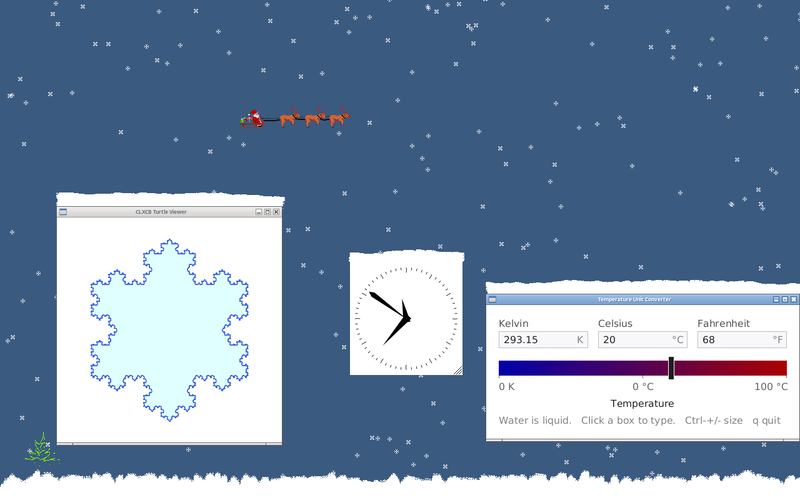

# Demo 7 — XSnow

<p align="center">
  <a href="screenshots/demo7.png">
    
  </a><br/>
</p>

A Common Lisp port of the classic X11 `xsnow` program. Snowflakes fall on your desktop, drift with changing wind gusts, and accumulate on top of open application windows and at the bottom of the screen. Santa Claus periodically flies across your desktop in a reindeer-drawn sleigh.

## Technical Highlights

- **Window kind**: `:root`.
- **Root & Overlay Drawing**:
  - Draws directly on the X11 virtual root window when running on traditional window managers.
  - On compositing window managers, automatically creates a transparent, click-through overlay window, enabling smooth alpha blending over desktop contents.
- **Window Obstacle Detection & Skyline**: Tracks desktop window configuration changes (`CreateNotify`, `ConfigureNotify`, `ReparentNotify`, `UnmapNotify`) to compute the skyline where snow lands on window title bars and borders.
- **Santa Animation**: Animated XPM sprites of Santa and reindeer flying across the screen, supporting both left-to-right and right-to-left flight paths.
- **Global Key Grabbing**: Intercepts keyboard shortcuts globally so you can control snow and wind without needing to focus a specific window.

> [!NOTE]
> Like XRoach and XNeko, this demo requires a real X11 server (or Xephyr/Xvfb). It will not work properly under pure XWayland, as Wayland security prevents clients from querying or drawing over other applications' windows.

## Loading in REPL

```lisp
;; Load the demos system
(asdf:load-system "clxcb-demos")

;; Start xsnow on root window
(demo7:run)

;; Start with custom snow accumulation and faster Santa
(demo7:run :accrate 2.0 :santa-speed 1.5)

;; Cleanly stop the demo from the REPL
(demo7:stop)
```

## Running with Makefile

```bash
# Run Demo 7
make demo7

# Or using friendly alias:
make xsnow

# Pass options:
make demo7 ARGS="--santa-speed 1.5 --accrate 2.0"
make demo7 ARGS="--no-santa"
make demo7 ARGS="--help"
```

## Options

`:verbose` (boolean, default: `nil`) — Print diagnostic and skyline messages (`--verbose`).
`:accrate` (number > 0, default: `1.0`) — Rate at which snow piles up on windows and the ground.
`:santa` (boolean, default: `t`) — Allow Santa to fly (`--santa` / `--no-santa`).
`:santa-speed` (number > 0, default: `1.0`) — Santa's flight speed multiplier.
`:santa-rate` (number 0..1, default: `1.0`) — Probability (0.0 to 1.0) of Santa flying after each pause.
`:santa-timeout` (number >= 0, default: `0.0`) — Seconds to wait between Santa's flights (0 to fly continuously).

## Controls (Globally Grabbed)

- `w`        Toggle **wind** simulation on/off.
- `Space`    Add **25 snowflakes**.
- `-`        Remove **25 snowflakes**.
- `?` or `/` Dump current internal physics and skyline state to standard output.

## Quit:

- `Ctrl+q`
- Stop from the REPL with `(demo7:stop)` (cleanly removes snow and restores desktop root)
