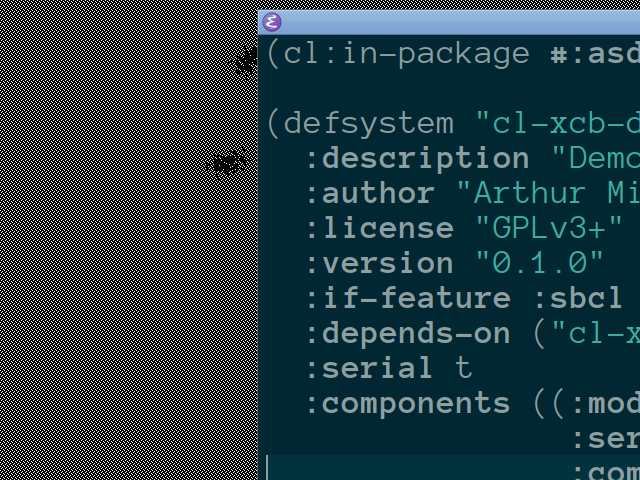

# Demo 8 — XRoach

<p align="center">
  <a href="../screenshots/08-xroach.png">
    
  </a><br/>
</p>

A Common Lisp port of the classic X11 `xroach` program to **CLXCB** (Common Lisp XCB bindings).

Cockroaches crawl on the desktop's root window and hide under client windows. When windows are moved, closed, or exposed, the uncovered roaches scamper for cover. With squishing enabled (`:squish t`), clicking on a roach squishes it.

## Technical Highlights

- **Window kind**: `:root`.
- **Root Window Rendering**: Draws directly onto the X11 virtual root window using XBM bitmaps loaded from `demo-8/sprites/` (`roach000.xbm` … `roach345.xbm`, `squish.xbm`).
- **Cover Detection**: Scans the root's mapped `InputOutput` child windows. A roach is considered hidden if its bounding box is within a mapped window.
- **Event Loop & Squish Handling**: Driven by `xact:run-widget`. Left-clicks are detected via pointer events to squish roaches when `:squish t` is enabled.

> [!NOTE]
> Like XSnow and XNeko, this demo requires a real X11 server (or Xephyr/Xvfb). It will not run properly under pure XWayland due to Wayland's security model.

## Loading in REPL

```lisp
;; Load the demos system
(asdf:load-system "clxcb-demos")

;; Start with default settings
(demo8:run)

;; Start with custom roach count, squishing enabled, and custom colors
(demo8:run :roaches 20 :squish t :roach-colour "brown" :guts-colour "yellowgreen" :speed 10.0)

;; Cleanly stop the demo from the REPL
(demo8:stop)
```

## Running with Makefile

```bash
# Run Demo 8
make demo8

# Or using friendly alias:
make xroach

# Pass options:
make demo8 ARGS="--roaches 25 --squish --speed 12.0"
make demo8 ARGS="--help"
```

## Options

`:roaches` (integer >= 1, default: `10`) — Number of roaches on screen.
`:squish` (boolean, default: `nil`) — Enable click-to-squish (`--squish` / `--no-squish`).
`:speed` (number > 0, default: `20.0`) — Movement speed of the roaches.
`:roach-colour` (string, default: `"black"`) — Colour of the roaches.
`:guts-colour` (string, default: `"yellowgreen"`) — Colour of squished roaches.
`:verbose` (boolean, default: `t`) — Print diagnostic messages.

## Controls

- `Left-click` Squish a roach (when `:squish` is enabled). The demo exits when the last roach is squished.
- `q` or `Escape` Quit the demo immediately.

## Quit:

- `q` or `Escape`
- Window manager close request (`WM_DELETE_WINDOW`)
- `Ctrl+C` in the terminal, if started from the shell or with `make`
- Stop from the REPL with `(demo8:stop)` (cleanly clears roaches and restores the root)

> [!TIP]
> On modern high-resolution screens and fast CPUs, the default speed of 20.0 can be quite fast. If you want to test squishing, running with a lower speed like `--speed 10.0` is recommended.

## Implementation Notes

Cover detection uses a single-rectangle test rather than Xlib's region arithmetic (which XCB does not provide). This catches the common case of a roach under a single window.

# Credits & License

## Original xroach

Copyright 1991 by J.T. Anderson (jta@locus.com).
This program may be freely distributed provided that all copyright notices are retained.
Dedicated to Greg McFarlane (gregm@otc.otca.oz.au).
Squish option contributed by Rick Petkiewizc (rick@locus.com).
Virtual root code adapted from patch sent by Colin Rafferty who borrowed it from Tom LaStrange.
Some glitches removed by patch from Guus Sliepen (guus@sliepen.warande.net) in 2001.

Original C version reference: https://github.com/interkosmos/xroach

## This Port

Lisp version: 2026 Arthur Miller (arthur.miller@live.com).
Distributed under the same terms as the original xroach: it may be freely distributed provided that all copyright notices are retained.
